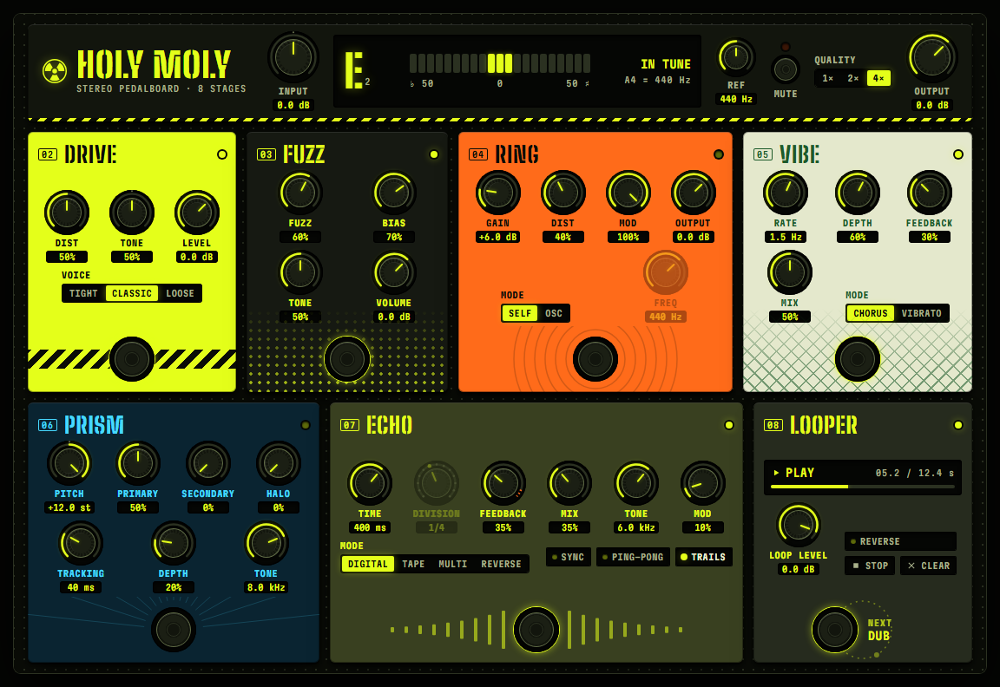

# Holy Moly

Stereo guitar pedalboard plugin designed to replicate Geordie Greep's fuzz sound.



- **Master & Tuner**: Input and output gain, 1× / 2× / 4× FIR oversampling, chromatic tuner with cents display, and master mute.
- **Drive**: Asymmetric overdrive with 3-way low-frequency voicing (Tight, Classic, Loose).
- **Fuzz**: Transistor fuzz shaper with variable bias gating and tone control, tailored for Geordie Greep's fuzz guitar tone.
- **Ring**: Dual-mode ring modulator (Self and Osc carrier) with wave shaper distortion.
- **Vibe**: 4-stage optical phase shifter with Chorus and Vibrato modes.
- **Prism**: Granular dual-stream pitch shifter (±12 semitones) with halo octave feedback.
- **Echo**: Multi-algorithm delay (Digital, Tape, Multi, Reverse) with host tempo sync, ping-pong stereo, and trails.
- **Looper**: 30-second sound-on-sound stereo phrase looper with reverse playback and MIDI control.

## Build

```sh
cargo xtask bundle holy_moly --release
```

Output: `target/bundled/Holy Moly.vst3`

Written in Rust
